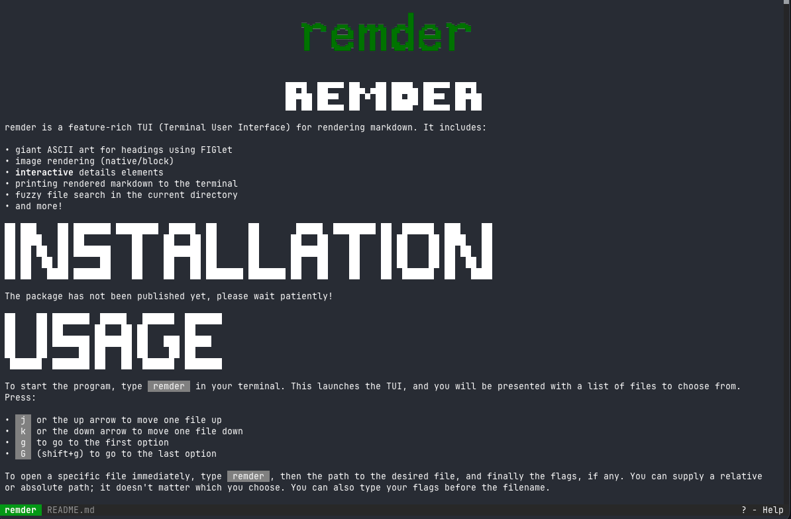
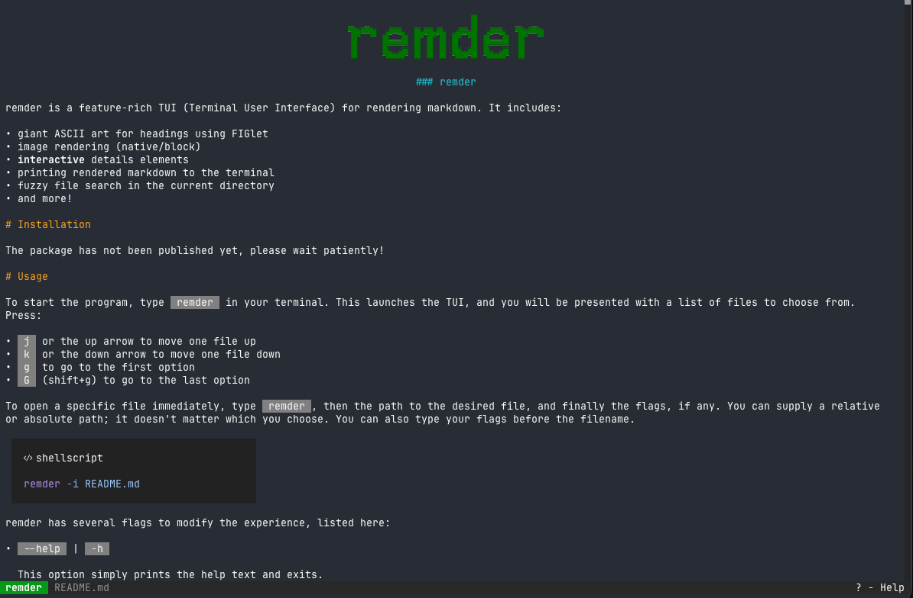
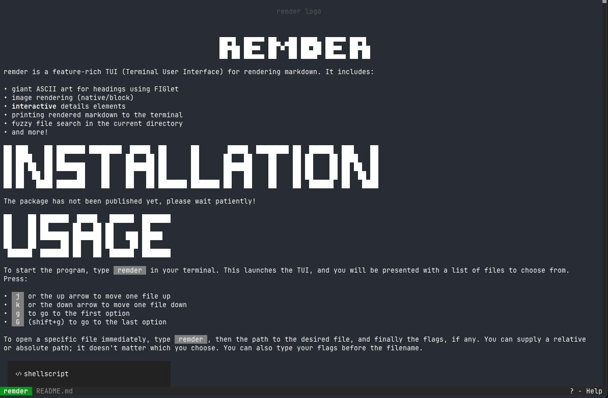
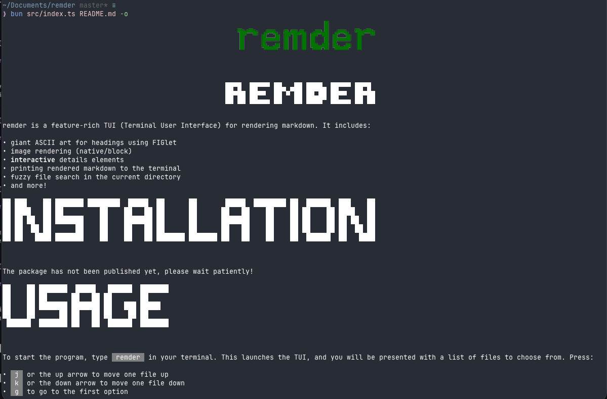
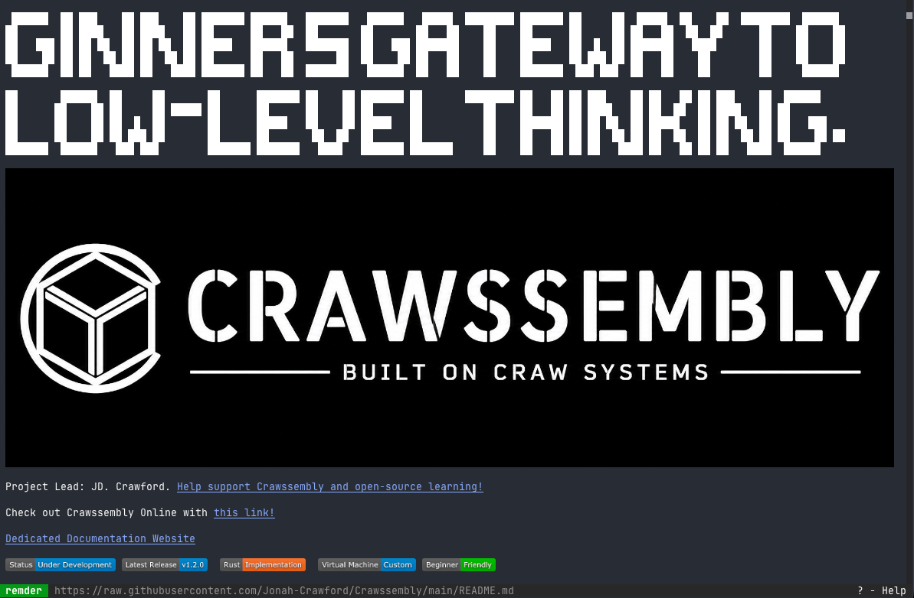
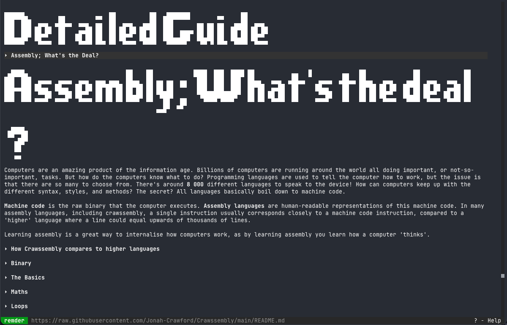

<p align="center">
  
</p>
<h3 align="center">remder</h3>

remder is a feature-rich TUI (Terminal User Interface) for rendering markdown. It includes:

- giant ASCII art for headings using FIGlet
- image rendering (native/block)
- **interactive** details elements
- printing rendered markdown to the terminal
- fuzzy file search in the current directory
- and more!

<details>
  <summary><b>Select to view screenshots</b></summary>

|                                            |        |
| :-------------------------------------------------------------------------------------------------------------------------------------------: | :---------------------------------------------------------------------------------------------------------------------------------------------------------: |
|                                             A screenshot of remder displaying the remder README.                                              |                                 A screenshot of remder displaying the remder README when `--no-render-headings` is enabled.                                 |
|  |                   |
|                           A screenshot of remder displaying the remder README when `--no-render-images` is enabled.                           |                                  A screenshot of the remder README printed to the console by enabling `--print-to-stdout`.                                  |
|                                         |  |
|                           A screenshot of the [Crawssembly](https://github.com/Jonah-Crawford/Crawssembly) README.                            |                A screenshot of the interactive details elements in the [Crawssembly](https://github.com/Jonah-Crawford/Crawssembly) README.                 |

</details>

# Installation

The package has not been published yet, please wait patiently!

# Usage

To start the program, type `remder` in your terminal. This launches the TUI, and you will be
presented with a list of files to choose from. Press:

- `j` or the up arrow to move one file up
- `k` or the down arrow to move one file down
- `g` to go to the first option
- `G` (shift+g) to go to the last option

To open a specific file immediately, type `remder`, then the path to the desired file, and finally
the flags, if any. You can supply a relative or absolute path; it doesn't matter which you choose.
You can also type your flags before the filename.

```bash
remder -i README.md
```

If you've copied some markdown, and you want to view it in a pretty way, you can pipe it into
remder.

```bash
echo "# hello world!" | remder
```

remder has several flags to modify the experience, listed here:

- `--help` | `-h`

  This option simply prints the help text and exits.

  ```bash
  remder --help
  remder -h
  ```

- `--debug` | `-d`

  This option allows you to press `C` (shift+c) to bring up the console.

  ```bash
  remder --debug
  remder -d
  ```

- `--no-render-headings` | `-H`

  Don't like the ASCII art headings? You can use this flag to disable those and use normal colored
  text instead!

  ```bash
  remder --no-render-headings
  remder -H
  ```

- `--disable-images` | `-i`

  If you have a slow internet connection or you just don't like the images (usually a result of
  rendering images with block characters), you can set this flag to simply show their alt text
  instead.

  ```bash
  remder --disable-images
  remder -i
  ```

- `--print-to-stdout` | `-p`

  If you want your styled text printed straight to the terminal, you have this option!

  ```bash
  remder --print-to-stdout
  remder -o
  ```

- `--width <number>` | `-w <number>`

  Set the width of the TUI or the rendered text. The default is the terminal width.

  ```bash
  remder --width 80
  remder -w 80
  ```

- `--height <number>` | `-y <number>`

  Set the height of the TUI. This flag has no effect on rendered text. The default is the terminal
  height.

  ```bash
  remder --height 40
  remder -h 40
  ```

## Combining flags

If you want to set multiple flags at once:

- If you are using **long flags** (for example `--no-render-headings`–they're the ones with the
  double dashes), you can combine them like this:
  ```bash
  remder --debug --disable-images --no-render-headings
  ```
  However, this is not recommended because of the verbosity i.e how much you have to type. Instead,
- Using **short flags** (for example `-H`–these are the ones with only one dash), you can combine
  them like this
  ```bash
  remder -d -i -H
  ```
  or even like this
  ```bash
  remder -diH
  ```
  The exceptions to this are the `-y` (`--height`) and the `-w` (`--width`) options. Since they take
  values, you cannot just join them like this. You need to specify them separately.
  ```bash
  remder -di -w 80
  ```
  This is not specific to remder, it is a feature of most shells. However, you don't need to know
  all about this, you only need to know that you can type very few letters to achieve your desired
  configuration, speaking of which...

## Configuration

remder doesn't have an option for a configuration. There's not much to customize, so you can instead
set an alias for options you use frequently. For example, if you use the `--disable-images` (or
`-i`) flag frequently, you can set an alias in your shell configuration file as given here.

```bash
# bash or zsh
alias rmder="remder -i"
```

```fish
# fish
alias rmder "remder -i"
```

```powershell
function rmder { remder -i }
```

<!--prettier-ignore-start-->
> [!CAUTION]
> Do not set the alias name to `remder`! Doing so results in a recursion
> loop that may **cause your shell to freeze and hang**.

> [!TIP]
> You can however set the alias name to anything you like, even as short
> as one letter, like `r`!
<!--prettier-ignore-end-->

<!-- # Comparison to other TUIs -->
<!---->
<!-- Now you might be wondering: why use this when there are other markdown TUIs? -->
<!-- Let's look at a comparison. -->
<!---->
<!-- |      Feature       | remder        | glow          | leaf          | md-tui        | -->
<!-- | :----------------: | ------------- | ------------- | ------------- | ------------- | -->
<!-- |       Themes       | Not available | Available     | Available     | Available     | -->
<!-- | ASCII art headings | Available     | Not available | Not available | Not available | -->
<!-- | Images by default  | Available     | Not available | Not available | Not available | -->
<!-- TODO: this thing will take a while. there's lots of competitors.-->

# Contributing

remder might be feature-rich, but there's always more to add! If you want to see a feature or you
find a bug, open a [Github issue](https://github.com/Keyboard1000n17/remder/issues) and we'll look
into it. Do consider _adding the feature yourself_ – it saves us a lot of work and we'd be really
grateful! Of course, if you find this repo useful, please shoot the repo a star!
